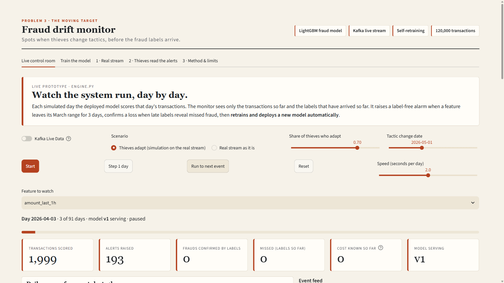
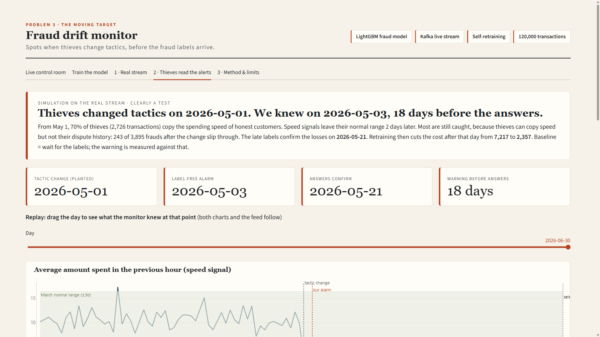
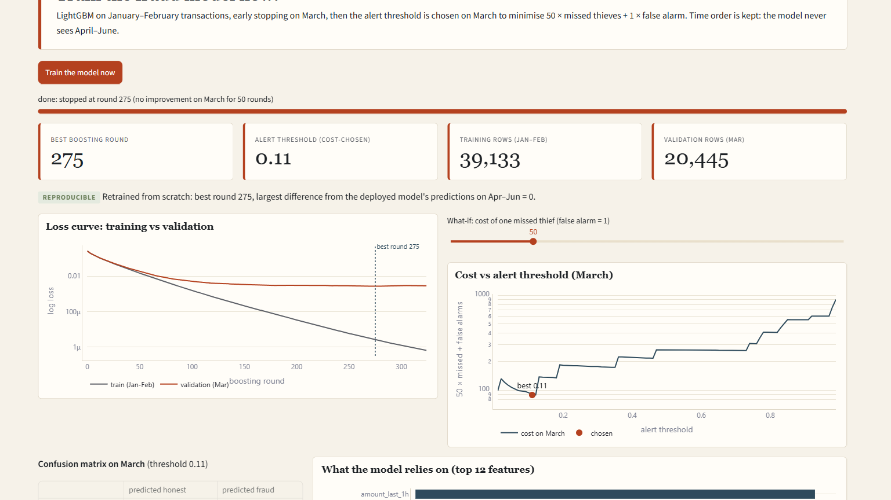

# The Moving Target: know when the world changed, before the answers arrive

**Run the demo (Windows, from this folder):**

```
.venv\Scripts\streamlit run app_drift.py
```

Opens at http://localhost:8501. Everything runs locally; no internet needed after setup.

**Tabs:**
- **Live control room**: the working prototype. Press Start: each simulated day the deployed model scores that day's
  transactions, the monitor raises label-free alarms, late labels arrive, and when they confirm a loss the system
  **retrains and deploys model v2 automatically**. Choose the real stream or a "thieves adapt" simulation.
- **Kafka Live Data** (toggle in the Live control room): new transactions stream in through a local Kafka broker
  (topic `txn-live`) from `producer.py`, which the app starts by itself. Press **Launch attack** and, from that day on,
  70% of thieves copy honest customers' spending speed; the alarm fires live, labels confirm later, model v2 is deployed.
  If Kafka is not running, the app says "Kafka not reachable, using local feed" and runs the same feed in-process.
  Start the broker first (Docker Desktop running):
  ```
  docker run -d --name kafka -p 9092:9092 apache/kafka:3.9.1
  ```
  Stop it with `docker rm -f kafka`. No API key: the broker runs on this laptop.
- **Train the model**: train LightGBM live (loss curve, cost-vs-threshold curve, confusion matrix, feature importance);
  it checks that the result reproduces the deployed model.
- **1–3**: the analysis: real-stream findings, the attack simulation with sensitivity and placebo tests, and the method
  and its limits.

## Problem

> Somewhere in a stream of transactions, a few people are stealing. They read your alerts. At some moment today they will
> change how they steal, and no one will tell you. Missing one thief costs as much as bothering fifty honest customers.
> Know when the world changed, before the answers arrive, and say how you know.

## What we built

A monitor that sits next to a fraud model on a transaction stream. It:

1. **Raises an alarm from the transactions alone**, before any fraud labels arrive.
2. **Says which signal moved** (the feature that left its normal range) and **who moved**: honest customers or thieves.
3. **Checks itself when the late labels arrive**, using each transaction's real label delay.
4. **Retrains only once the labels confirm a loss**, and shows the cost before and after.

The alert threshold follows the cost rule: one missed thief costs 50, one false alarm costs 1.

## Screenshots

Captured from the running app (`app_drift.py`, 1536×864, Playwright):

- `docs/screenshots/01-live-control-room.png`: live replay on day 3, alerts and cost counters updating.
- `docs/screenshots/02-thieves-read-the-alerts.png`: simulated tactic change on 2026-05-01, alarm on 2026-05-03, confirmed by labels on 2026-05-21.
- `docs/screenshots/03-train-the-model.png`: live training, stopped at round 275, cost-vs-threshold curve, confusion matrix.





## Results

| | Real stream | Simulation: thieves read the alerts |
|---|---|---|
| Change | Dataset's own drift starts 2026-04-01 | We plant a tactic change on 2026-05-01 |
| Label-free alarm | **2026-04-03**, `device_change_7d` | **2026-05-03**, spending-speed features |
| Who changed (no labels used) | Non-alerted traffic explains the shift → **honest customers** | Alerted traffic explains the shift → **thieves** |
| Labels confirm a loss | Never (missed fraud stays flat) | 2026-05-21 → **18 days of warning** |
| Action | Keep the model | Retrain: cost after 05-21 falls from **7,217 to 2,357** |

In the simulation, 70% of thieves (2,726 transactions) copy honest spending speed from May 1. Most are still caught,
because they can copy speed but not their dispute history: 243 of 3,895 frauds after the change slip through.

**How small a change can we catch?** (`sensitivity.py`: 5 shares × 3 start dates × 3 seeds)

| Share of thieves adapting | Label-free layer | Days from change to alarm | Warning before labels |
|---|---|---|---|
| 70–90% | caught 18/18 | 2 | 13–16 days |
| 50% | caught 7/9 | 2–7 | 11–17 days |
| 10–30% | missed 0/18 | – | none (only the late labels catch it) |

**False alarms:** the same rule on 3 calm windows where nothing changed raised **0 alarms across 33 numeric features**.

Fraud model (LightGBM, trained Jan–Feb, threshold tuned on March, tested Apr–Jun): 1 missed thief and 161 false alarms
on 60,422 transactions, cost 211.

## How it works

| Step | Script | Output |
|---|---|---|
| 1. Clean and split by time | `prep_drift.py` | `data/clean.joblib`, `data/cleaning_log.txt` |
| 2. Fraud model + cost threshold | `train_drift.py` | `model_drift.joblib`, `metrics_drift.json` |
| 3. Monitor, diagnosis, simulation, retrain | `monitor.py` | `monitor.json` |
| 3b. Sensitivity grid + placebo test | `sensitivity.py` | `sensitivity.json` |
| 4. Live engine (day-by-day replay, alarms, late labels, auto-retrain) | `engine.py` | used by the website |
| 5. Consistency test: live replay = batch results | `check_engine.py` | prints PASS |
| 5b. Live feed: Kafka producer + consumer, local fallback | `livefeed.py`, `producer.py` | used by the website |
| 5c. Live feed test (fallback always, Kafka if running) | `check_live.py` | prints PASS |
| 6. Website | `app_drift.py` | live tabs use `engine.py`; analysis tabs read the JSON files |

Rebuild everything from the CSV (about 2 minutes):

```
.venv\Scripts\python prep_drift.py
.venv\Scripts\python train_drift.py
.venv\Scripts\python monitor.py
.venv\Scripts\python sensitivity.py
.venv\Scripts\python check_engine.py
```

**Label-free layer.** Each feature's daily mean is compared with its March mean ± 3σ, and must stay outside for
3 days in a row. Two more checks run alongside: 7-day PSI per feature, and a control chart on the daily alert rate.

**Who changed.** The alarm window is split by the model's own alert flag. Each group's share of the shift
(its share of traffic × the change in its mean) decides: non-alerted → honest customers, alerted → thieves.

**Label-based layer.** Each missed fraud is counted on the day its label arrives (transaction day + its real delay from
the dataset). A 7-day sum above the March limit confirms the change.

**Why March as the reference.** In January–February, `days_since_last_transaction` starts at a 90-day cap for most rows
and decays. A Jan–Feb reference raises false alarms on that warm-up.

## Data

Kaggle: [Credit Card Fraud Detection with Drift 2026](https://www.kaggle.com/datasets/mohankrishnathalla/credit-card-fraud-detection-with-drift-2026)
by mohankrishnathalla, license **CC0-1.0**. 120,000 transactions, 73 columns, Jan–Jun 2026, fraud rate 9.5%, label delay
0–45 days. The organizers provided no data.

**Removed as leakage (29 columns):** drift labels (`drift_phase`, `drift_magnitude`, `concept_drift_score`, ...),
`fraud_type`, dispute and chargeback outcomes (`dispute_*`, `num_chargebacks_ever`), `post_transaction_outcome`,
`pseudo_label`, label timing, and IDs. They are known only after the transaction or give away the answer.
The drift labels are used only to check the detector.

## Is the live system honest?

The engine reads the same CSV that holds future rows, so honesty depends on one rule: every decision uses only
`seen()`, the rows up to the current simulated day, and only labels whose arrival day has passed. `check_engine.py`
replays both scenarios day by day and checks that every alarm date, the confirmation date, the retrain size and the
costs equal the batch results exactly. A model retrained in the control room lives in memory only.

## Limits

- The dataset is public but its drift is engineered by the uploader.
- Fraud is almost fully separable here by spending-speed features, so the model's score (AUC ≈ 0.99999) is much higher
  than real fraud allows. The monitor is the contribution, not the score.
- The "thieves read the alerts" scenario is a simulation planted on the real stream, not observed behavior.
- The detector watches feature averages. A tactic change that keeps every average the same would not be seen early.
- The alarm needs 3 days of evidence.
- When only 10–30% of thieves adapt, the label-free layer misses it.
- Part of the warning comes from slow labels: Apr–May fraud labels arrive after ~30 days (median) in this dataset.
- Thieves who evade completely look like normal traffic, so a shift in non-alerted traffic could also be hidden thieves.
  The late labels are the tie-breaker (on the real data they show the fraud share flat).
- The label limit is low because March has almost no missed fraud: 2 missed frauds in 7 days confirms.

## Setup on a new machine

```
python -m venv .venv
.venv\Scripts\pip install -r requirements-drift.txt
```

Download the CSV from the Kaggle link into `data\credit_card_fraud_drift_2026.csv`, then run the three scripts above.
